# LOANLY

LOANLY is a simple, all-in-one web app that takes the math out of managing your money. Clients can see how much they owe, which lenders or companies they owe, and where their income goes without losing time to manual calculations—while admins get a centralized portal to review, approve, or reject loan requests and monitor lending activity.

---

## Screenshots

### Landing page
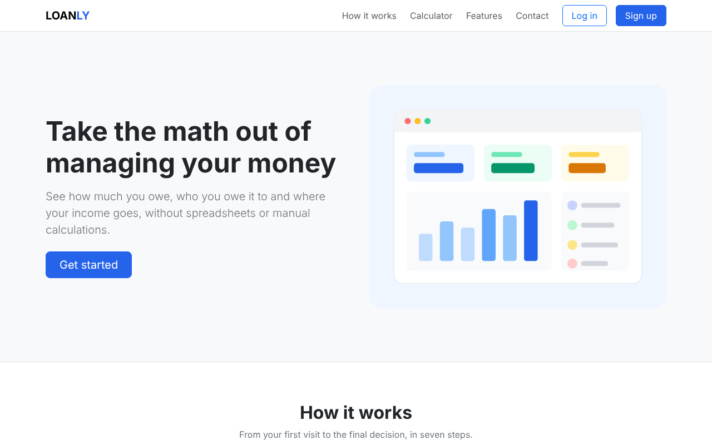

### Client
| Dashboard | Apply for a loan |
|---|---|
| 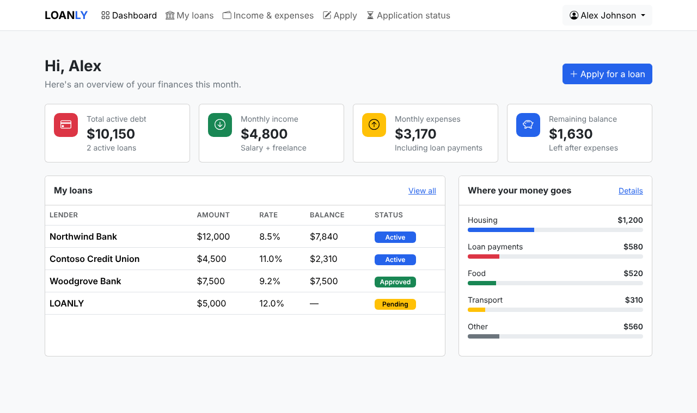 | 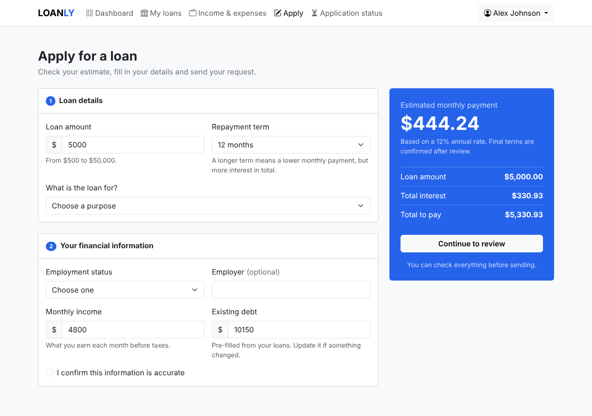 |
| **Application status** | **My loans** |
| 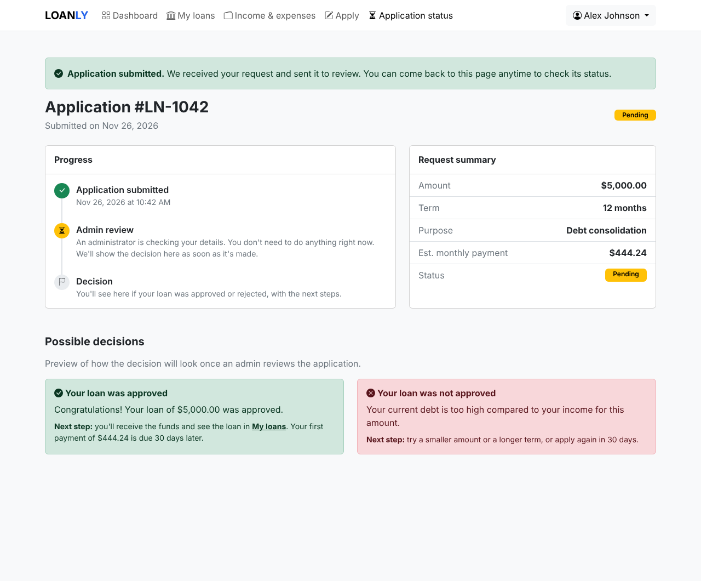 | 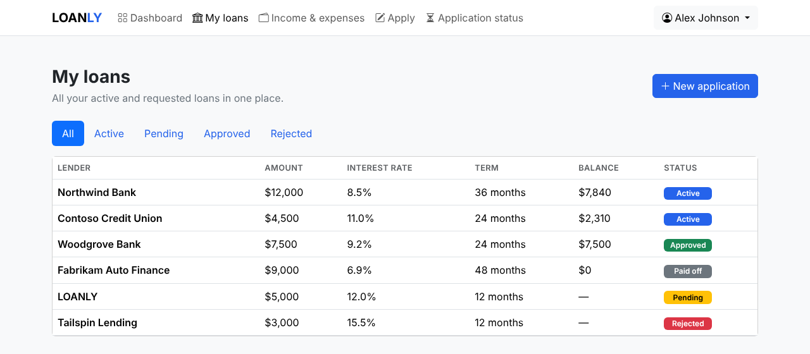 |

### Admin
| Application queue | Review an application |
|---|---|
| 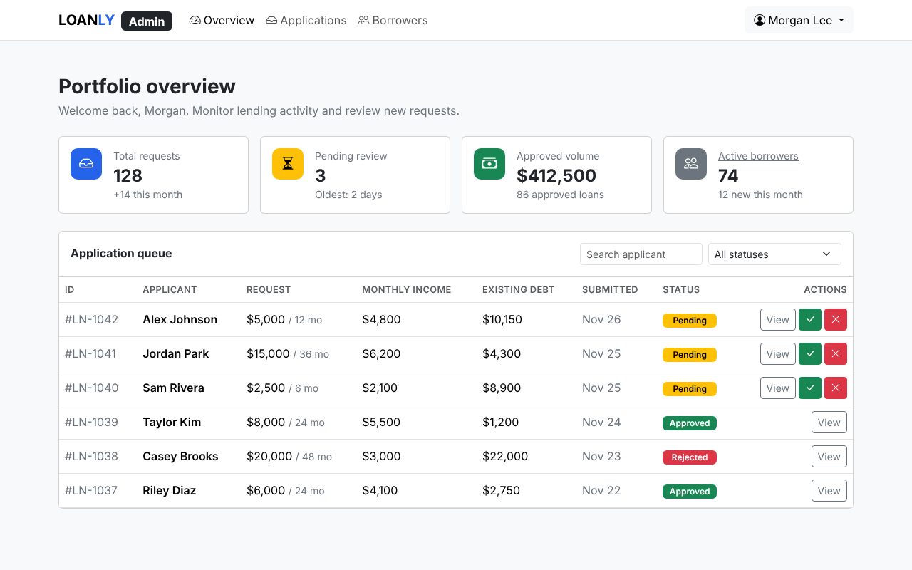 | 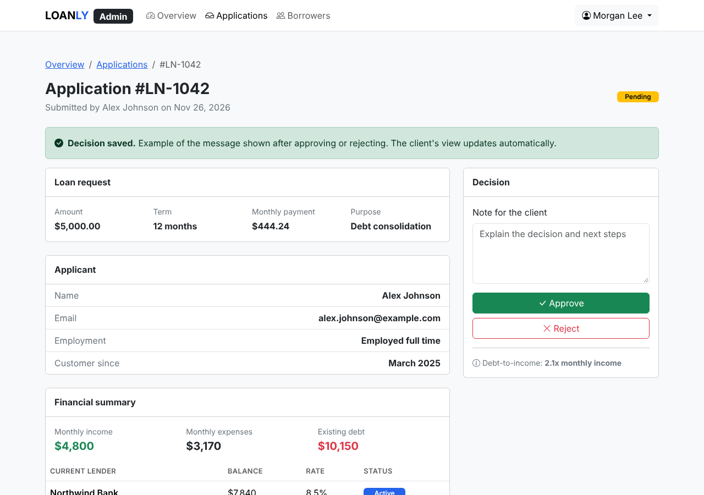 |

### Mobile
<p>
  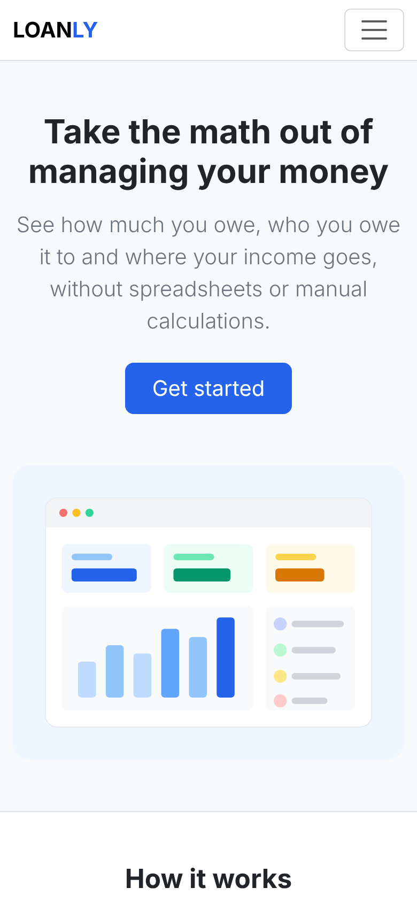
  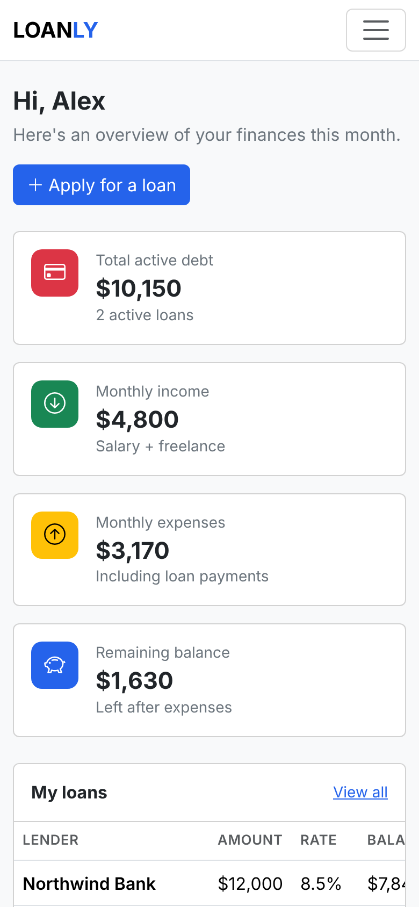
</p>

More screenshots in [`docs/screenshots`](docs/screenshots).

---

## Features

### For Clients
* **Financial Overview:** View total active debt, monthly income, monthly expenses, and remaining balance at a glance.
* **Loan & Lender Tracking:** Keep track of active and requested loans, including lender names, amounts, interest rates, and live status updates (`Pending`, `Approved`, `Rejected`).
* **Income & Expense Log:** Record income and spending categories so cash flow is calculated automatically without spreadsheets.
* **Loan Calculator & Application:** Estimate repayments clearly before applying, submit loan requests with confirmation feedback, and track review progress.

### For Admins
* **Application Queue:** View submitted loan requests alongside applicant details, income, and existing debt.
* **One-Click Decisions:** Approve or reject applications with clear saved-status feedback that automatically updates the client's view.
* **Portfolio Overview:** Monitor total loan requests, approved volume, and active borrower records.

---

## User Journey

1. **Awareness:** Visit the homepage to learn what LOANLY offers and click **Get Started**.
2. **Consideration:** Review the application steps and required details in plain language.
3. **Registration:** Create an account or log in through a clean, validated form.
4. **Loan Calculation:** Enter loan amounts and repayment terms to view a clear repayment estimate.
5. **Application:** Complete and submit the loan request with instant submission confirmation.
6. **Admin Review:** Track the application's `Pending` status while an administrator reviews the details.
7. **Decision:** View the final `Approved` or `Rejected` decision along with clear next steps.

---

## UX Research

The interface is based on the UX maps for the project: user journey map, personas and emotional journey map.

📄 **Full document:** [Loan_Manager_UX_Maps.pdf](docs/ux/Loan_Manager_UX_Maps.pdf)

| User journey map | Emotional journey map |
|---|---|
| 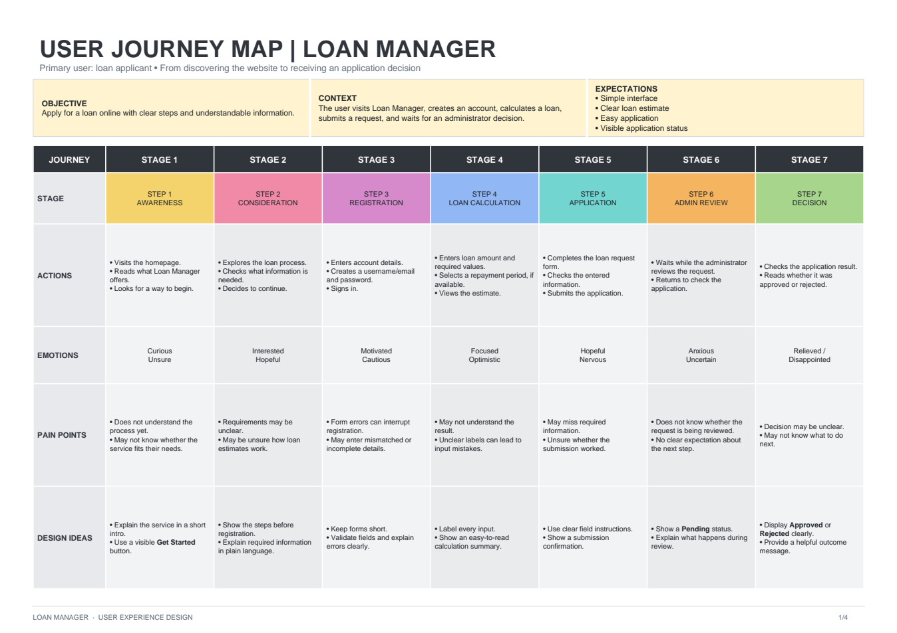 | 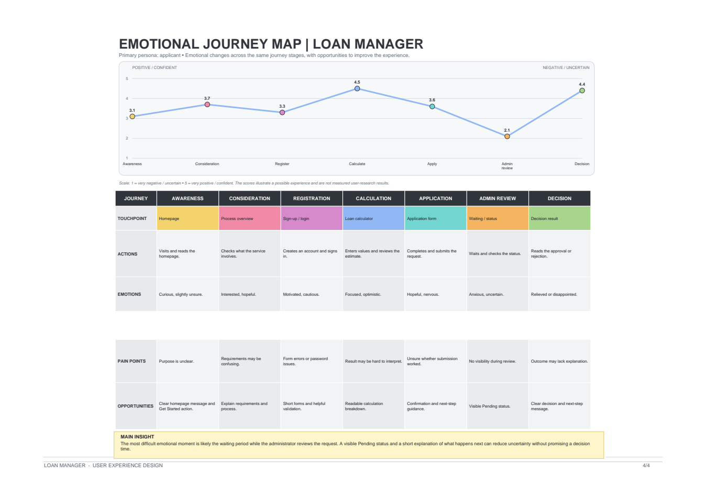 |
| **Persona: applicant (Alex Johnson)** | **Persona: administrator (Morgan Lee)** |
| 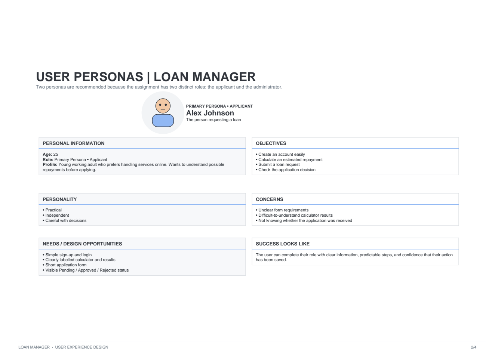 | 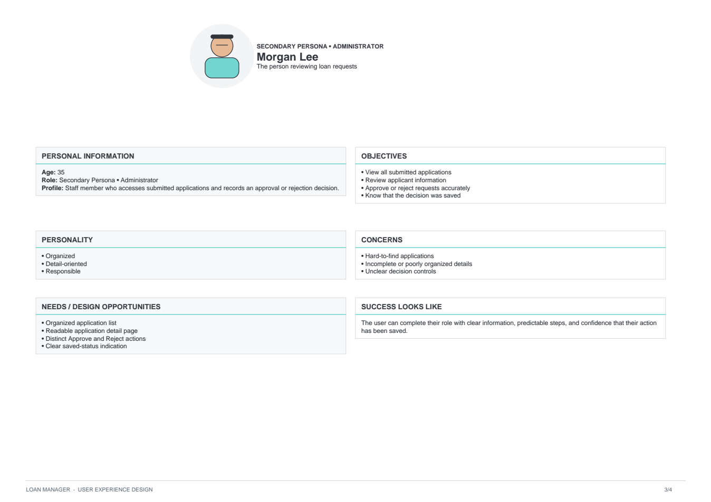 |

> **Main insight:** the hardest moment for the applicant is waiting while the admin reviews the request. The app shows a visible `Pending` status and explains what happens next, without promising a decision time.

---

## How to Use It

### Clients
1. Open the application link <>.
2. Sign up for a new account or log in to an existing one.
3. Enter your income, expenses, and loan details—LOANLY handles all calculations and tracks your application statuses automatically.

### Admins
1. Log in using an authorized admin account.
2. Open the admin portal to inspect incoming loan applications and borrower profiles.
3. Click **Approve** or **Reject** to record a decision and update the client's status immediately.

---

## Tech Stack

* **Frontend:** HTML, CSS, JavaScript, [Bootstrap 5](https://getbootstrap.com/) and [Bootstrap Icons](https://icons.getbootstrap.com/) (via CDN)
* **Backend:** Basic server/API 
* **Database:** JSON

---

## Project Structure

```
frontend/
├── index.html                 # Landing page
├── login.html                 # Log in
├── register.html              # Sign up
├── dashboard.html             # Client: financial overview
├── loans.html                 # Client: loans and lenders
├── finances.html              # Client: income and expense log
├── apply.html                 # Client: loan application form
├── apply-review.html          # Client: review before submitting
├── application.html           # Client: application status and decision
├── admin.html                 # Admin: portfolio overview and application queue
├── admin-application.html     # Admin: review and decide an application
├── admin-borrowers.html       # Admin: borrower records
├── css/
│   ├── styles.css             # Brand colors and landing styles
│   └── app.css                # Shared styles for client and admin pages
├── js/
│   └── main.js                # Landing page calculator and navbar
└── img/
    └── hero.svg
docs/
├── screenshots/               # App screenshots used in this README
└── ux/                        # UX maps (PDF and page previews)
```

---

## Running Locally

No build step is needed. Serve the `frontend` folder with any static server:

```bash
cd frontend
python -m http.server 8000
```

Then open http://localhost:8000. The admin portal is at http://localhost:8000/admin.html.

---

## Notes for Development

The app pages are **UI only**: the data shown is placeholder data (personas Alex Johnson and Morgan Lee) and no logic is connected yet.

* Every form field has a `name` attribute and forms use `action="#"`, ready to be connected to the API.
* Validation messages are already in the HTML (`.invalid-feedback`). Add the `was-validated` class to a form to show them ([Bootstrap validation](https://getbootstrap.com/docs/5.3/forms/validation/)).
* Still to do with JavaScript: password confirmation match, loan estimate on `apply.html`, filters and search, and loading real data from the backend.
